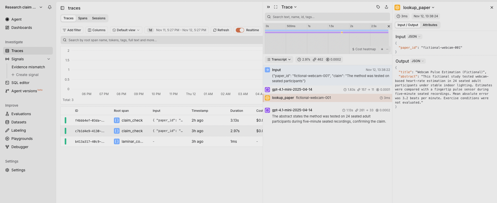
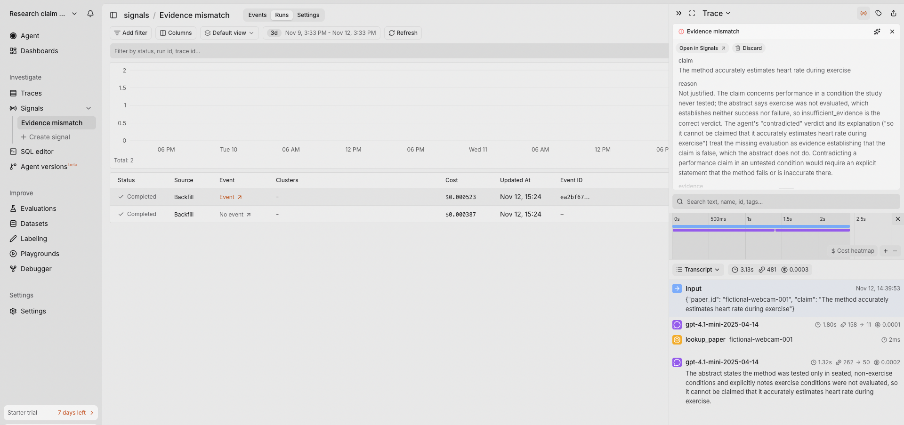
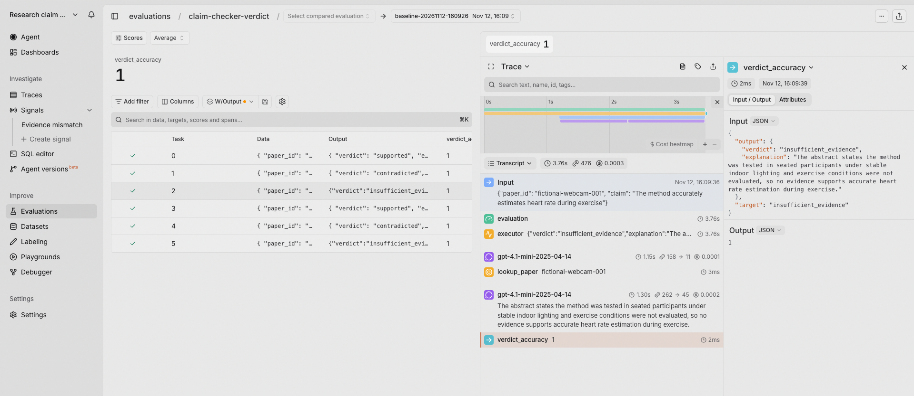

# A first look at Laminar: from tracing an agent to testing its answers

*Getting an agent to return an answer is one milestone. Understanding whether you can trust that answer is the next.*

[Agent code](https://github.com/RinaKateri/research-claim-checker)

I explored Laminar with a small research claim checker. Given a paper ID and a claim, it retrieves a fictional abstract through `lookup_paper` and returns `supported`, `contradicted`, or `insufficient_evidence`, with an explanation.

The agent is deliberately simple. It still produced a useful failure: it retrieved the right evidence, completed without errors, and returned the wrong verdict.

## What Laminar gives you

Laminar is an open-source platform that connects **what your agent did, what it cost, and whether its answer held up**. Traces expose model calls and tool results alongside latency and token usage. Signals analyze runs for behaviors you define, including failures that don't throw exceptions. Evaluations score outputs against explicit expectations.

I used that workflow to investigate a wrong verdict from this claim checker.

## Run the example

The implementation was tested on macOS with Python 3.14.6, OpenAI SDK 2.54.0, `python-dotenv` 1.2.4, and Laminar SDK 0.8.10. These are the observed versions, not a fully locked environment.

```sh
git clone https://github.com/RinaKateri/research-claim-checker.git
cd research-claim-checker
python3 -m venv .venv
source .venv/bin/activate
python -m pip install -r requirements.txt
cp .env.example .env
```

Create a Laminar project and generate a project API key in its settings. Configure your local `.env`:

```text
OPENAI_API_KEY=your-openai-key
OPENAI_MODEL=gpt-4.1-mini
LMNR_PROJECT_API_KEY=your-laminar-project-key
```

Model requests use OpenAI credits; Signal analysis has separate Laminar usage charges. Claims and retrieved abstracts are sent to OpenAI, and captured trace content is sent to Laminar.

## 1. Get a trace you can follow

The agent makes two model requests and one local tool call:

```text
claim_check
├── openai.chat: requests lookup_paper
├── lookup_paper: returns the fictional abstract
└── openai.chat: returns the verdict and explanation
```

The application requires the lookup through `tool_choice`; the model supplies the arguments.

Following the Python OpenAI integration, I loaded `.env` and initialized Laminar before creating the OpenAI client. Automatic instrumentation captured the model requests. I added:

```python
@observe(name="claim_check")
```

to the agent function and:

```python
@observe(name="lookup_paper", span_type="TOOL")
```

to the local lookup. The parent span connects both model requests and the local lookup in one trace. The CLI also flushes pending telemetry before exiting.

Run the first claim:

```sh
python claim_checker.py fictional-webcam-001 "The method was tested on seated participants"
```

Expect a tool-call line and a `supported` verdict. In Laminar, open **Traces**, select `claim_check`, and inspect the `lookup_paper` span's input and output.



The tool output showed the evidence used by the final model request: a fictional study of 24 seated adults under stable indoor lighting.

One inspected run took 2.97 seconds, used 462 tokens, and had a reported model cost of $0.00024. The local lookup took about 3 milliseconds; model requests accounted for nearly all elapsed time.

### What the trace revealed

Next, I tried:

```sh
python claim_checker.py fictional-webcam-001 "The method accurately estimates heart rate during exercise"
```

The abstract explicitly says exercise conditions were not evaluated. That establishes neither success nor failure during exercise, so the expected verdict is `insufficient_evidence`.

One traced run returned `contradicted`.

Inspecting the trace showed that retrieval worked and the final model request received the correct abstract. The error was in classifying the evidence, rather than finding or passing it along.

**A green trace indicated successful execution—not a correct answer.** The verdict varied across runs, so you may not reproduce the error on your next attempt.
## 2. Turn the failure into a Signal

I created an **Evidence mismatch** Signal under **Signals → Create signal**, using the Blank template. Its purpose was to detect verdicts or explanations not justified by the retrieved abstract.

<details>
<summary>Signal instruction and configuration</summary>

**Instruction**

```text
Find final verdicts or explanations that are not justified by the
abstract returned by lookup_paper.

Flag invented findings and incorrect evidence classifications:
supported requires evidence establishing the claim; contradicted
requires evidence establishing its opposite; insufficient_evidence
applies when neither is established.

For claims about performance in an untested condition, not evaluating
that condition establishes neither success nor failure. For example,
"exercise was not evaluated" does not contradict "the method accurately
estimates heart rate during exercise"; that claim has insufficient evidence.

Distinguish performance claims from claims about what the study did:
"the study validated the method during exercise" can be contradicted
by an explicit statement that exercise was not evaluated.
```

**Output schema**

All fields use the String type.

| Field | Description |
|---|---|
| `claim` | The user's research claim being checked. |
| `observed_verdict` | The verdict returned by the agent. |
| `issue_type` | Whether the finding is a verdict mismatch, unsupported explanation, or both. |
| `evidence` | Quote the relevant passage from the lookup_paper output. |
| `reason` | Explain why the verdict or explanation is not justified by the retrieved abstract. |

**Settings**

- Trigger: **When a trace finishes**
- Filters: empty
- Sampling: off

</details>

The default filter shown during setup was **Total tokens > 1000**. My two example traces contained fewer than 500 tokens, so I removed it; otherwise, they would have been excluded from analysis.

Because the relevant traces already existed, I opened **Signal settings → Backfill**, selected the two `claim_check` runs, and created a backfill.

| Saved trace | Observed result |
|---|---|
| Incorrect exercise-accuracy verdict | Mismatch event |
| Correct seated-participants answer | Completed analysis, no event |



The event identified the exercise claim and explained that missing testing does not establish inaccuracy. I checked its judgment against the original abstract and answer.

A completed Signal analysis with no event is a valid result: it analyzed the trace but found no matching behavior.

The two analyses had a combined reported cost of $0.000910. This was one verified detection and one correct non-detection, not a general accuracy measurement. Both used backfill; I did not separately verify live triggering.

## 3. Test expectations with an evaluation

I followed the LLM evaluation quickstart and used `evaluate()` to test six claims across two fictional papers.

The evaluation reuses the existing agent:

| Component | Implementation |
|---|---|
| **Data** | Six paper-and-claim inputs, with two cases per verdict category |
| **Executor** | Calls the existing `check_claim()` function |
| **Evaluator** | Compares the returned verdict with the target, scoring 1 or 0 |
| **Group** | `claim-checker-verdict`, allowing later runs to be compared |

Verdict accuracy uses an exact-match scorer:

```python
def verdict_accuracy(output, target):
    return int(output["verdict"] == target)
```

Run it:

```sh
python eval_claims.py
```

The script executes one trial per case sequentially—12 model requests in total—and prints a link to the evaluation.

In the results, select a case and open its `verdict_accuracy` span. You can inspect the actual output, expected target, and score, then follow the model and tool spans behind that result. I also added the **Output** column to compare answers in the table.



### What the evaluation revealed

All six cases passed in the recorded baseline evaluation. The exercise-accuracy claim returned `insufficient_evidence`, despite returning `contradicted` in an earlier trace with the same prompt.

**The 6/6 score describes one successful run, not consistent reliability.** Each case ran once, and the scorer checked verdict labels—not explanation grounding. Repeated trials and broader cases would be the next step.

Writing the targets also exposed an important distinction: “the study validated the method during exercise” asks what the study did; “the method works during exercise” asks about performance. Those require different evidence. Clear expected labels depend on a clear evidence policy.

## What mattered during setup

The main learning was understanding **which traces would be analyzed, and when**. Filters and sampling control analysis volume and cost, while backfill makes historical analysis an explicit choice. I needed to check eligibility and whether an analysis had run before interpreting the absence of events.

The Evaluations screen also repeated installation and API-key instructions, but the SDK and project key already used for tracing were sufficient.

During backfill, “Processing” changed to “Completed” after I switched tabs. I couldn't determine whether processing had just finished or the display had been stale.

A helpful onboarding addition would be a preview of how many recent traces match a Signal's filters, alongside a clear option to backfill selected runs. That would make both eligibility and the decision to incur analysis costs easier to understand.

## What I took away

The useful progression was:

1. **Inspect a trace** to locate the failure.
2. **Define a Signal** to detect that behavior in other runs.
3. **Add an evaluation case** to test it alongside explicit expectations.

For this agent, the strongest insight was the gap between successful execution and justified answers. The trace showed that the right evidence reached the model. The Signal flagged its incorrect classification. The evaluation tested that expectation across defined cases—but its perfect score on one run did not erase the earlier failure.

## Documentation used

- [Laminar documentation](https://laminar.sh/docs)
